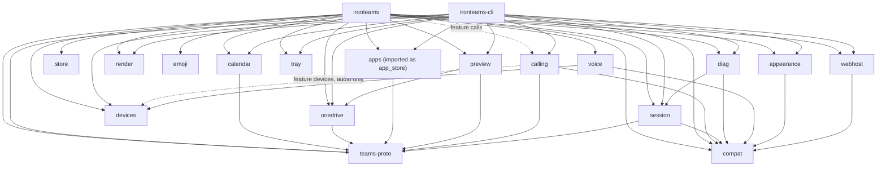

# IronTeams crates Blueprint

## System Overview
`crates/` holds every member of the Cargo workspace (`Cargo.toml`: `members = ["crates/*"]`, `exclude = ["spikes"]`, edition 2024). IronTeams is an unofficial native Microsoft Teams client in Rust. Two binaries sit on top of a set of library crates:

- `ironteams`: the Slint desktop app. Slint callbacks on the UI thread send `Cmd` values to a backend `Engine` running on a tokio runtime, and the engine pushes view data back through a `UiHandle`.
- `ironteams-cli`: a hand-parsed command-line client used to test the protocol live. Its MCP server is behind the `mcp` cargo feature, which is off by default.

The libraries form layers. Lower crates never depend on higher ones (path dependencies in each `Cargo.toml`):

- **Protocol layer:** `teams-proto` owns sign-in, token minting and every Teams, Graph and Substrate request. It depends on no other workspace crate.
- **Feature services:** `calendar`, `onedrive`, `preview`, `apps` and `calling` each wrap one service family on top of `teams-proto`.
- **Local and platform crates:** `store` (SQLite), `session` (keyring and config; depends on `teams-proto` and `compat`), `appearance` (prefs and portal), `render` (pure HTML and Markdown), `emoji` (static table), `voice` (depends on `devices`), `devices`, `tray`, `webhost`, `diag` (depends on `session`). `store`, `render`, `emoji`, `tray`, `devices` and `teams-proto` have no workspace dependencies.
- **`compat`:** reads `KELMA_*` env vars as a fallback and migrates old `kelma` data folders. `appearance`, `calling`, `session`, `diag`, `voice`, `webhost` and both binaries depend on it.
- **Binaries:** `ironteams` depends on every library (`calling` only through the `calls` feature). `ironteams-cli` depends on all of them except `store`, `emoji` and `voice`; `calling` is not optional there. The `apps` package is imported as `app_store` in both.

## Subdirectories & System Boundaries
- ironteams: [./ironteams/EGM.md](./ironteams/EGM.md) - Slint desktop app (binary). Build script, start-up, UI glue, backend engine, desktop cards, updater. `calls` feature (default) gates the `calling` dependency.
- ironteams-cli: [./ironteams-cli/EGM.md](./ironteams-cli/EGM.md) - CLI for live protocol testing (binary). Commands make real writes to the signed-in account. Optional stdio MCP server in [./ironteams-cli/src/mcp/EGM.md](./ironteams-cli/src/mcp/EGM.md).
- teams-proto: [./teams-proto/EGM.md](./teams-proto/EGM.md) - Teams protocol client: `Client`, `Session`, token broker, trouter push loop, and request builders and parsers for chat, teams, media, people, search, settings and M365 apps.
- calling: [./calling/EGM.md](./calling/EGM.md) - native Teams calls: NGC signalling, trouter call pushes, TURN relay, WebRTC media (Opus, H.264, SCTP), audio I/O with echo cancellation, screen share, camera, effects, captions, history, voicemail.
- calendar: [./calendar/EGM.md](./calendar/EGM.md) - Outlook calendar over Graph: events, delta cache, scheduling, permissions, meet-now, ICS export.
- onedrive: [./onedrive/EGM.md](./onedrive/EGM.md) - OneDrive and SharePoint over Graph, plus the SharePoint REST recycle bin.
- preview: [./preview/EGM.md](./preview/EGM.md) - PDF page rendering (hayro) and Office-to-PDF conversion through Graph.
- apps: [./apps/EGM.md](./apps/EGM.md) - Teams apps: app bar, Store catalog, install requests, policy, grants, messaging-extension bots.
- store: [./store/EGM.md](./store/EGM.md) - SQLite cache: schema migrations, outbox, drafts, saved messages, history gaps, Arabic-aware FTS5 search.
- session: [./session/EGM.md](./session/EGM.md) - refresh tokens in the system keyring, `config.json`, accounts and tenants, window state.
- appearance: [./appearance/EGM.md](./appearance/EGM.md) - theme, accent, density, font scale, accessibility, snippets, language and formats, XDG desktop portal reader.
- render: [./render/EGM.md](./render/EGM.md) - pure text: Teams HTML to and from rich text, Markdown to Teams HTML, link detection, composer edits with undo. Sub-contract [./render/src/rich/EGM.md](./render/src/rich/EGM.md).
- emoji: [./emoji/EGM.md](./emoji/EGM.md) - generated static emoji table with search, shortcodes, autocomplete, skin tones.
- voice: [./voice/EGM.md](./voice/EGM.md) - voice messages: record, AAC-in-MP4 encode (ffmpeg or native), decode, waveform peaks, playback.
- devices: [./devices/EGM.md](./devices/EGM.md) - audio and camera enumeration, streams, level meter, loopback, device prefs.
- tray: [./tray/EGM.md](./tray/EGM.md) - StatusNotifierItem tray (Linux only), unread badge, launcher badge, screen-lock probe, input-idle probe (`idle::idle_for`, used for presence Away; Linux and Windows), autostart.
- webhost: [./webhost/EGM.md](./webhost/EGM.md) - Chromium `--app` window driven over CDP, with an optional TeamsJS host shim for web apps.
- diag: [./diag/EGM.md](./diag/EGM.md) - local problem-report bundle (`.tar.gz`) with redaction. Nothing is uploaded.
- compat: [./compat/EGM.md](./compat/EGM.md) - `KELMA_*` env fallbacks and one-time migration of old `kelma` folders to `ironteams`.

## Global Invariants
- **Bearer tokens stay on their own host.** `teams-proto` attaches a token only to https URLs on that audience's own host. AMS and URL-preview downloads refuse non-service hosts. `calling` sends its IC3 bearer only to Microsoft calling hosts through `routed_url`. See `teams-proto/EGM.md` and `calling/EGM.md`.
- **Secrets never reach plain storage or logs.** Refresh tokens live only in the system keyring (`session`). The `store` kv table is unencrypted and must hold no secrets. `Debug` impls of token types never print token values (`teams-proto`). `diag` redacts identity fields before it writes a bundle.
- **Sends can be retried safely.** Message sends take a caller-chosen `client_message_id`, so a retry with the same id does not duplicate the message (`teams-proto`). `store` runs an outbox (queued, sending, failed), and `sending` rows reset to `queued` when the store opens. `calendar::create_event` fills a `transactionId`.
- **Writes are atomic and lenient.** Config and prefs files are written atomically and loaded leniently (`session`, `appearance`, `tray` autostart).
- **The `kelma` to `ironteams` rename is handled in one place.** `IRONTEAMS_*` env vars win over `KELMA_*`. Legacy folders and keyring entries migrate once, through `compat` and `session`.
- **Cargo features gate the heavy native parts.** `ironteams/calls` (default) gates `calling`. `calling` has `devices` (default, pulls in `devices` with only its `audio` feature), `aec`, `screen-share`, `camera` and `effects`. `devices` has its own `audio` and `cameras` features, both on by default. `ironteams-cli/mcp` is off by default. The tray, Wayland desktop cards and remote control are Linux-only.

## Global Side Effects
- **Network:** Microsoft services only, all reached through `teams-proto` or crates built on it: chat service, middle tier, CSA, presence, AMS, Graph, Substrate, SharePoint, Outlook REST, trouter, NGC conversation service, TURN relays. One exception: `ironteams` talks to GitHub releases, through the `update_check` API call and through the `velopack` self-updater (delta or full package downloads in the background, applied only on "Restart to update" or when the app quits). Only Velopack installs (Setup.exe, .pkg, AppImage) update themselves.
- **Disk (per-user folders):** SQLite database (`store`), `config.json` and `window-state.json` (`session`), prefs JSON files (`appearance`), media cache and backups (`ironteams`), autostart entries (`tray`: XDG `.desktop` file, macOS LaunchAgent plist, Windows per-user Run registry value), MCP allowlist and audit log (`ironteams-cli/mcp`), report bundles (`diag`).
- **System:** keyring, D-Bus (portals, tray, notifications, screen saver, GNOME idle monitor), Windows registry (autostart Run key) and `GetLastInputInfo` (idle time), audio and camera devices, V4L2.
- **Child processes:** `ffmpeg`, `gst-launch-1.0`, `pw-dump`, `fc-match`, `pactl` (`devices`, sink and source listing), Chromium, `taskkill` (Windows, `webhost` stops the browser process tree), and `ironteams` re-spawning its own executable (desktop-card host process, restart from Settings).
- **Live account writes:** messages, presence, calendar, OneDrive and teams. `ironteams-cli` commands do these against the real signed-in account.

## System Verification
- Run: `cargo test --workspace` (or `cargo test -p <crate>` for one crate; package names match folder names).

---
Docs synced to commit c7516012 ("Merge fix/release-0.1.9: version 0.1.9", 2026-11-24). All contracts under `crates/` were checked against this commit; start the next drift check from `git log c7516012..HEAD`.
